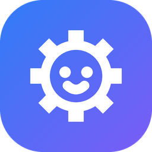

<p align="center"></p>

# Gearbit

[Русский](README.md) · **English**

A Windows app to **drive a construction-kit robot from a PC and program it** with blocks (Scratch-style), Python and C#. It is made for a parent and a child working together at a big monitor with a keyboard, mouse and gamepad.

The first supported robot is the **Apitor / Makerzoid SuperBot** (TUDAO controller, Bluetooth LE). The architecture is ready for other similar robots: they can be added as adapters.

> ⚠️ This is an unofficial project, not affiliated with Apitor or Makerzoid. The protocol was reverse-engineered. Everything runs locally: no cloud, no accounts, no data collection.

> 🌐 The Gearbit interface is in English and Russian. On first start it follows the Windows language; you can switch it in the settings (⚙).

## What it can do

- **Gearbit.exe**: a WPF + WebView2 window with the hub inside, dark title bar in the night theme.
- **Remote control**: keyboard (WASD/arrows), on-screen buttons and joystick, gamepad; sensors, lights and each motor separately.
- **Blocks**: Scratch-style block programming (scratch-blocks), sensor and tilt events, variables, examples, saving to a file.
- **Python and C#**: an editor with highlighting and hints, the same simple API in both (`robot.forward(50)` / `robot.Forward(50);`), clear errors in English or Russian, examples.
- **Line following**: sensors look at the floor and the robot follows black electrical tape; a **Line** track in the emulator.
- **Emulator**: a virtual car in a room with obstacles that speaks the real byte protocol; you can tilt it.
- **Measurements**: hand-made frames to the robot, a power test, sensor calibration and a recording of all traffic — to pin down the protocol on a real robot.
- **Safety**: STOP from anywhere, a 600 ms dead man's switch, a power limit per build, one controller at a time.
- **Language and looks**: the interface in English and Russian (on first start — by the Windows language), light, dark and auto theme, 5 accent colors, large text. Settings, the tab and the window are remembered.
- **Program history**: like Local History in an IDE — earlier versions of blocks, Python and C# programs are kept in `%LOCALAPPDATA%\Gearbit\History`.
- **Hub**: JSON-RPC 2.0 over WebSocket on localhost. The remote, blocks, Python and C# all work through it.

## Status

| Stage | What | Status |
|---|---|---|
| 0 | Measuring the protocol on the robot | ⏳ values come from open sources so far (`verified: false`) |
| 1 | Core, hub, emulator, remote, themes, window | ✅ done, waiting for a check on the robot |
| 2 | Blocks (Scratch-style) | ✅ done, checked on the emulator |
| 3 | Python | ✅ done, checked on the emulator |
| 4 | C# | ✅ done, checked on the emulator |
| 5 | Simulator and challenges | — |

## Quick start (developer)

You need: Windows 10/11, .NET SDK 10, Node.js 20+, Bluetooth 4.0+ (for a real robot). For Python programs — Python 3 from python.org.

```bash
git clone https://github.com/EugeneSoftwareDeveloper/Gearbit.git
cd Gearbit
dotnet build
dotnet test
dotnet run --project src/Gearbit.App
```

`dotnet build` builds the web interface by itself (`web/studio-ui`, via npm) if it isn't there yet or its sources have changed.

In the window, click **Connect** and pick **Nordic_TUDAO (emulator)**: it works without hardware. Drive with W A S D, stop with Space.

The hub without a window (for a browser and external clients): `dotnet run --project src/Gearbit.Server` → http://localhost:5280. More in [docs/en/dev/building.md](docs/en/dev/building.md).

## Documentation

**For users** ([docs/en/user](docs/en/user/README.md)):
- [Getting started](docs/en/user/getting-started.md)
- [Remote control](docs/en/user/remote-control.md)
- [Blocks](docs/en/user/blocks.md)
- [Python](docs/en/user/python.md) and [C#](docs/en/user/csharp.md)
- [Line following](docs/en/user/line-following.md)
- [Safety](docs/en/user/safety.md)
- [Questions and problems](docs/en/user/faq.md)
- [Measurements](docs/en/user/measurements.md)

**For developers** ([docs/en/dev](docs/en/dev/README.md)):
- [Plan and stages](docs/en/PLAN.md)
- [Architecture](docs/en/ARCHITECTURE.md)
- [SuperBot protocol](docs/en/PROTOCOL-SUPERBOT.md) and [measurement checklist](docs/en/STAGE0-CHECKLIST.md)
- [Building and running](docs/en/dev/building.md)
- [Hub API (JSON-RPC)](docs/en/dev/hub-api.md)
- [Blocks inside](docs/en/dev/blocks.md)
- [Adding a new robot](docs/en/dev/adding-a-robot.md)
- [Interface and themes](docs/en/dev/ui-and-themes.md)

The docs come in two languages: Russian is the main one (`docs/`), English is a copy in [`docs/en`](docs/en/user/README.md). If you change one, change the other.

**For AI agents**: [AGENTS.md](AGENTS.md) (in Russian). Repository rules, commands, safety invariants.

## Layout

```
src/        .NET: Core, protocols, transports, emulator, hub, server, WPF app, C# client, script runner
web/        web interface (TypeScript + Vite)
python/     the gearbit package for Python programs
devices/    robot descriptions (JSON)
profiles/   builds (JSON)
tests/      tests
tools/      helper scripts
docs/       documentation (docs/en — in English)
```

## License

Gearbit is free software under the [GNU GPL version 3](LICENSE) (`GPL-3.0-only`). You may run, study, change and share it. If you distribute a modified version, publish its source code under the same license.

Third-party libraries shipped with Gearbit and their licenses are listed in [THIRD-PARTY-NOTICES.md](THIRD-PARTY-NOTICES.md). Apitor, Makerzoid and Scratch are trademarks of their owners.
