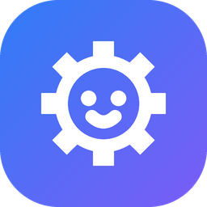

<p align="center"></p>

# Gearbit

**Русский** · [English](README.en.md)

[](https://github.com/EugeneSoftwareDeveloper/Gearbit/actions/workflows/ci.yml)

Программа для Windows, чтобы **управлять роботом-конструктором с ПК и программировать его** блоками (в стиле Scratch), на Python и C#. Рассчитана на занятия с ребёнком за большим монитором, с клавиатурой, мышью и геймпадом.

Первый поддерживаемый робот — **Apitor / Makerzoid SuperBot** (контроллер TUDAO, Bluetooth LE). Архитектура рассчитана на другие похожие роботы: их можно добавлять как адаптеры.

> ⚠️ Проект неофициальный и не связан с Apitor или Makerzoid. Протокол получен обратной разработкой. Всё работает локально: без облака, аккаунтов и сбора данных.

## Что уже есть

- **Gearbit.exe**: окно WPF + WebView2 со встроенным хабом, тёмный заголовок в ночной теме.
- **Пульт**: клавиатура (WASD/стрелки), экранные кнопки и джойстик, геймпад; датчики, свет, моторы по отдельности.
- **Блоки**: программирование блоками в стиле Scratch (scratch-blocks), события от датчиков и наклона, переменные, примеры, сохранение в файл.
- **Python и C#**: редактор с подсветкой и подсказками, одинаковый простой API (`robot.forward(50)` / `robot.Forward(50);`), понятные ошибки на русском или английском, примеры.
- **Езда по линии**: датчики смотрят в пол, робот едет по чёрной изоленте; трасса «Линия» в эмуляторе.
- **Эмулятор**: виртуальная машинка в комнате с препятствиями, говорит на настоящем байтовом протоколе; её можно наклонять.
- **Замеры**: кадры роботу вручную, тест мощности, калибровка датчиков, запись обмена — чтобы уточнить протокол на настоящем роботе.
- **Безопасность**: СТОП отовсюду, «кнопка мертвеца» 600 мс, предел мощности сборки, один управляющий за раз.
- **Язык и оформление**: интерфейс на русском и английском (при первом запуске — по языку Windows), светлая, тёмная и авто-тема, 5 цветов, крупный текст. Настройки, вкладка и окно запоминаются.
- **История программ**: как Local History в IDE — прежние версии блоков, Python и C# хранятся в `%LOCALAPPDATA%\Gearbit\History`.
- **Хаб**: JSON-RPC 2.0 по WebSocket на localhost. Через него работают пульт, блоки, Python и C#.

## Скачать

Готовая сборка для Windows 10/11 x64 — на странице [Releases](https://github.com/EugeneSoftwareDeveloper/Gearbit/releases/latest): скачайте `Gearbit-…-win-x64.zip`, распакуйте и запустите `Gearbit.exe`. Ставить .NET не нужно. Подробнее — в [первых шагах](docs/user/getting-started.md).

## Статус

| Этап | Что | Статус |
|---|---|---|
| 0 | Замеры протокола на роботе | ⏳ значения пока из открытых источников (`verified: false`) |
| 1 | Ядро, хаб, эмулятор, пульт, темы, окно | ✅ готово, ждёт проверки на роботе |
| 2 | Блоки (в стиле Scratch) | ✅ готово, проверено на эмуляторе |
| 3 | Python | ✅ готово, проверено на эмуляторе |
| 4 | C# | ✅ готово, проверено на эмуляторе |
| 5 | Симулятор и задания | — |

## Быстрый старт (разработчик)

Нужно: Windows 10/11, .NET SDK 10, Node.js 20+, Bluetooth 4.0+ (для реального робота). Для программ на Python — Python 3 с python.org.

```bash
git clone https://github.com/EugeneSoftwareDeveloper/Gearbit.git
cd Gearbit
dotnet build
dotnet test
dotnet run --project src/Gearbit.App
```

`dotnet build` сам собирает веб-интерфейс (`web/studio-ui`, через npm), если его ещё нет или исходники изменились.

В окне нажмите **«Подключить»** и выберите **«Nordic_TUDAO (эмулятор)»**: он работает без железа. Езда — клавишами W A S D, стоп — пробел.

Хаб без окна (для браузера и внешних клиентов): `dotnet run --project src/Gearbit.Server` → http://localhost:5280. Подробнее — в [docs/dev/building.md](docs/dev/building.md).

## Документация

**Пользователям** ([docs/user](docs/user/README.md)):
- [Первые шаги](docs/user/getting-started.md)
- [Пульт и управление](docs/user/remote-control.md)
- [Блоки](docs/user/blocks.md)
- [Python](docs/user/python.md) и [C#](docs/user/csharp.md)
- [Езда по линии](docs/user/line-following.md)
- [Безопасность](docs/user/safety.md)
- [Занятия с ребёнком](docs/user/lessons.md): программа от 6 лет
- [Вопросы и проблемы](docs/user/faq.md)
- [Замеры](docs/user/measurements.md)

**Разработчикам** ([docs/dev](docs/dev/README.md)):
- [План и этапы](docs/PLAN.md)
- [Архитектура](docs/ARCHITECTURE.md)
- [Протокол SuperBot](docs/PROTOCOL-SUPERBOT.md) и [чек-лист замеров](docs/STAGE0-CHECKLIST.md)
- [Сборка и запуск](docs/dev/building.md)
- [API хаба (JSON-RPC)](docs/dev/hub-api.md)
- [Блоки изнутри](docs/dev/blocks.md)
- [Как добавить нового робота](docs/dev/adding-a-robot.md)
- [Интерфейс и темы](docs/dev/ui-and-themes.md)

Документация есть на двух языках: русская — основная (`docs/`), английская — копия в [`docs/en`](docs/en/user/README.md). Меняете одну — меняйте и другую.

**ИИ-агентам**: [AGENTS.md](AGENTS.md). Правила репозитория, команды, инварианты безопасности.

## Структура

```
src/        .NET: Core, протоколы, транспорты, эмулятор, хаб, сервер, WPF-приложение, клиент C#, запуск скриптов
web/        веб-интерфейс (TypeScript + Vite)
python/     пакет gearbit для программ на Python
devices/    описания роботов (JSON)
profiles/   сборки (JSON)
tests/      тесты
tools/      вспомогательные скрипты
docs/       документация (docs/en — на английском)
```

## Лицензия

Gearbit — свободная программа под лицензией [GNU GPL версии 3](LICENSE) (`GPL-3.0-only`). Её можно запускать, изучать, менять и распространять. Если вы распространяете изменённую версию, откройте её исходный код под той же лицензией.

Чужие библиотеки, которые входят в Gearbit, и их лицензии перечислены в [THIRD-PARTY-NOTICES.md](THIRD-PARTY-NOTICES.md). Apitor, Makerzoid и Scratch — товарные знаки их владельцев.
