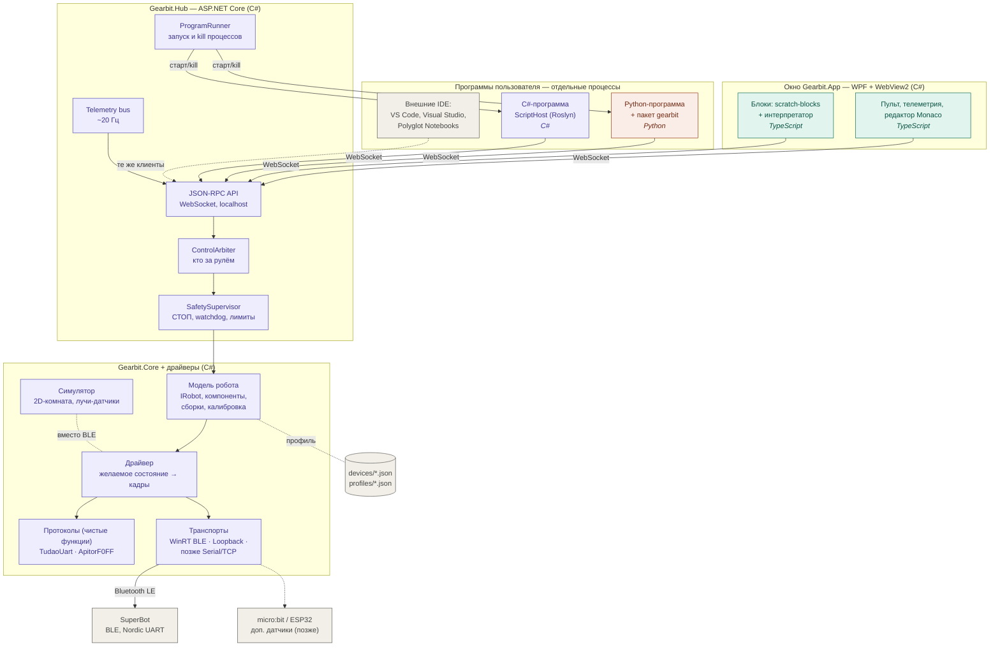
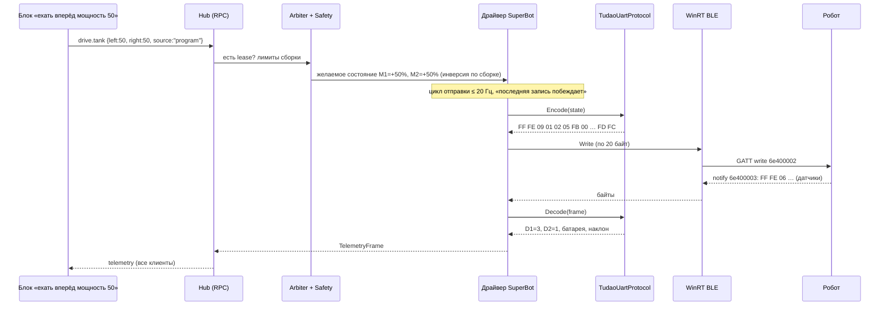
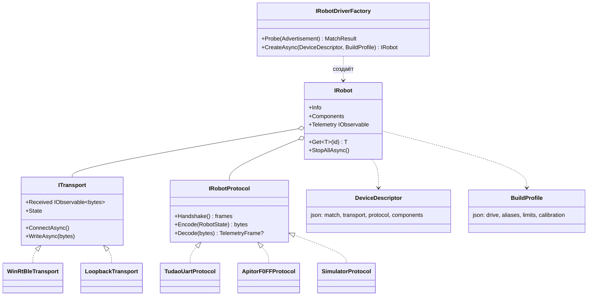

# Gearbit — архитектура компонентов

Сопутствующие документы: [PLAN.md](PLAN.md) (план и этапы), [PROTOCOL-SUPERBOT.md](PROTOCOL-SUPERBOT.md) (протокол).

## 1. Общая схема

Цвет обозначает язык: 🟪 C# · 🟩 TypeScript/JS · 🟧 Python · ⬜ данные и железо.

## 2. Компоненты: язык, технология, ответственность

| Компонент | Язык / технология | Отвечает за | Этап |
|---|---|---|---|
| **Gearbit.App** | C#, WPF + WebView2 | Окно на весь экран, запуск хаба, хостинг веб-UI | 1 |
| **studio-ui** | TypeScript, Vite, Lit/Preact, Monaco | Пульт, телеметрия, переключатель режимов, редакторы Python/C#, консоль | 1, 3, 4 |
| **studio-ui / blocks** | TypeScript, scratch-blocks (Blockly 12) | Вкладка «Блоки»: редактор, блоки робота на русском, интерпретатор — клиент хаба | 2 |
| **Gearbit.Hub** | C#, ASP.NET Core (Kestrel), JSON-RPC | Единственный владелец робота: API, арбитр, безопасность, телеметрия, запуск программ | 1 |
| **Gearbit.Core** | C# (.NET 10, без I/O) | `IRobot`, компоненты-возможности, сборки, калибровка, лимиты | 1 |
| **Gearbit.Protocols.Tudao** | C# (чистые функции) | Кодирование кадров `FF FE…FD FC`, разбор телеметрии 11/19 байт | 1 |
| **Gearbit.Protocols.Apitor** | C# | Кадры `55 AA…` (Robot J) — проверка расширяемости | 6 |
| **Gearbit.Transport.WinRtBle** | C#, WinRT `Windows.Devices.Bluetooth` | Скан, подключение, запись чанками, уведомления, переподключение | 1 |
| **Gearbit.Simulator** | C# (модель) + TS (отрисовка на canvas) | Виртуальный робот с теми же компонентами | 5 |
| **Gearbit.ScriptHost** | C#, Roslyn Scripting | Компиляция и запуск C#-скриптов в отдельном процессе | 4 |
| **Gearbit.Client** | C# (NuGet) | Клиент хаба для своих C#-программ и Notebooks | 4 |
| **gearbit** (pip) | Python 3 (`websockets`) | Клиент хаба для Python, простой синхронный API | 3 |
| **Python embeddable** | CPython (portable) | Python без установки | 3 |
| **devices/\*.json** | JSON | Описание модели робота: как найти, UUID, компоненты, параметры протокола | 1 |
| **profiles/\*.json** | JSON | Сборки: какой мотор левый, инверсия, куда смотрят датчики, лимиты | 1 |
| **tools/ble-sniffer** | C# (консоль) | Скан, сырые кадры, ручная отправка hex (разбор новых роботов) | 0/1 |

## 3. Как проходит команда

СТОП идёт мимо очереди: `emergency.stop` → Safety → нулевое состояние → немедленная отправка, без ожидания цикла.

## 4. Как устроен драйвер (адаптеры)

**Чтобы добавить новый робот**, нужно:
1. описать его в `devices/<id>.json`;
2. если формат кадров новый, написать `IRobotProtocol`: чистые функции и тесты на захваченных кадрах;
3. если связь новая (USB, Wi-Fi), написать `ITransport`;
4. добавить сборки в `profiles/`.

Хаб, UI, редактор блоков, Python- и C#-клиенты при этом не меняются: они видят только возможности.
