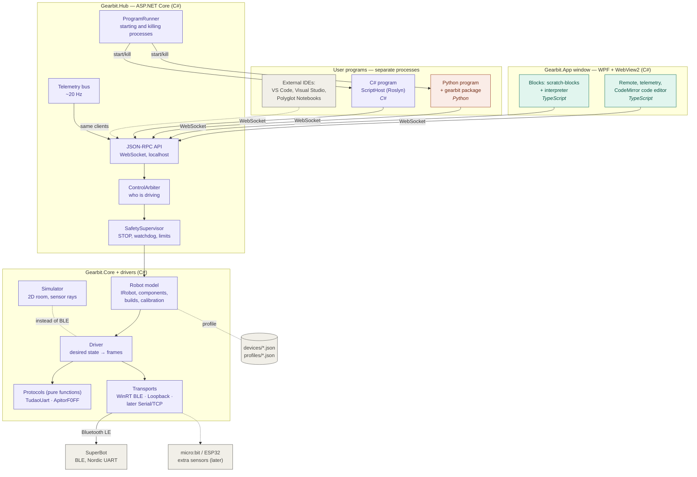
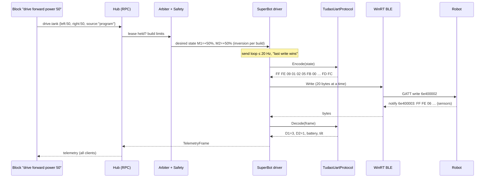
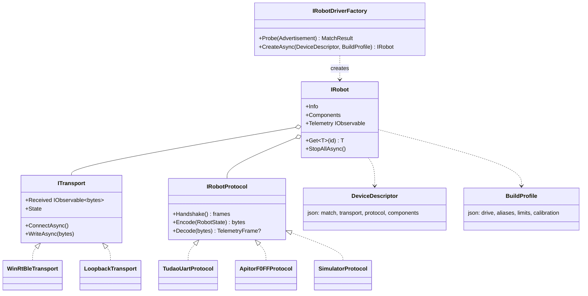
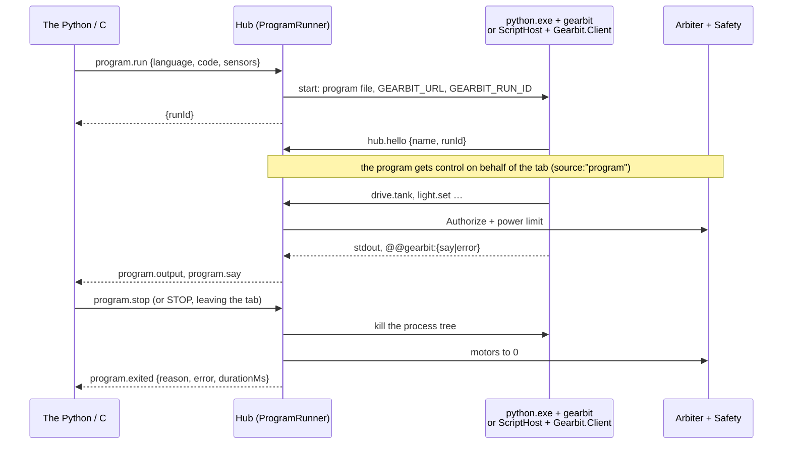

# Gearbit — component architecture

[Русский](../ARCHITECTURE.md) · **English**

Related documents: [PLAN.md](PLAN.md) (plan and stages), [PROTOCOL-SUPERBOT.md](PROTOCOL-SUPERBOT.md) (protocol).

## 1. Overview

Color shows the language: 🟪 C# · 🟩 TypeScript/JS · 🟧 Python · ⬜ data and hardware.

## 2. Components: language, technology, responsibility

| Component | Language / technology | Responsible for | Stage |
|---|---|---|---|
| **Gearbit.App** | C#, WPF + WebView2 | A full-screen window, starting the hub, hosting the web UI | 1 |
| **studio-ui** | TypeScript, Vite, no framework | Remote, telemetry, mode switcher, protocol log | 1 |
| **studio-ui / code** | TypeScript, CodeMirror 6 | The Python and C# tabs: editor, output, «Команды» (Commands), running via `program.run` | 3, 4 |
| **studio-ui / blocks** | TypeScript, scratch-blocks (Blockly 12) | The Blocks tab: editor, robot blocks in Russian, the interpreter is a hub client | 2 |
| **Gearbit.Hub** | C#, ASP.NET Core (Kestrel), JSON-RPC | The only owner of the robot: API, arbiter, safety, telemetry, running programs | 1 |
| **Gearbit.Core** | C# (.NET 10, no I/O) | `IRobot`, capability components, builds, calibration, limits | 1 |
| **Gearbit.Protocols.Tudao** | C# (pure functions) | Encoding `FF FE…FD FC` frames, parsing 11/19-byte telemetry | 1 |
| **Gearbit.Protocols.Apitor** | C# | `55 AA…` frames (Robot J) — an extensibility check | 6 |
| **Gearbit.Transport.WinRtBle** | C#, WinRT `Windows.Devices.Bluetooth` | Scan, connect, chunked writes, notifications, reconnect | 1 |
| **Gearbit.Simulator** | C# (model) + TS (canvas rendering) | A virtual robot with the same components | 5 |
| **Gearbit.ScriptHost** | C#, Roslyn Scripting | Compiling and running C# scripts in a separate process | 4 |
| **Gearbit.Client** | C# (a library, later NuGet) | A synchronous hub client: scripts in ScriptHost, your own C# programs and Notebooks | 4 |
| **gearbit** (the `python/` folder) | Python 3.9+, standard library only | The hub client for Python, a simple synchronous API, clear errors in Russian | 3 |
| **Python** | CPython 3.9+ from python.org or portable in `python\runtime` | Runs Python programs; the hub finds it itself (`PythonLanguage`) | 3 |
| **devices/\*.json** | JSON | A robot model description: how to find it, UUIDs, components, protocol parameters | 1 |
| **profiles/\*.json** | JSON | Builds: which motor is left, inversion, where sensors look, limits | 1 |
| **tools/ble-sniffer** | C# (console) | Scanning, raw frames, sending hex by hand (studying new robots) | 0/1 |

## 3. How a command travels

STOP skips the queue: `emergency.stop` → Safety → zero state → sent immediately, without waiting for the loop.

## 4. How the driver is built (adapters)

**To add a new robot** you need to:
1. describe it in `devices/<id>.json`;
2. if the frame format is new, write an `IRobotProtocol`: pure functions and tests on captured frames;
3. if the link is new (USB, Wi-Fi), write an `ITransport`;
4. add builds to `profiles/`.

The hub, the UI, the block editor, the Python and C# clients don't change: they only see capabilities.

## 5. How a Python or C# program works

A user program is a **separate process** and a regular hub client. This way a hung or crashed program doesn't take the window down with it, and STOP can always kill it.

- `ProgramRunner` (`src/Gearbit.Hub/Programs`) keeps one program per client, knows who started it, and ends it on STOP, when the owner leaves, when the robot is lost and when the hub closes.
- A language is described by `IProgramLanguage`: how to find the runtime and how to run a file. There are `PythonLanguage` (`python.exe`) and `CSharpLanguage` (`csharp\Gearbit.ScriptHost.exe`).
- A C# program is a Roslyn Scripting script. ScriptHost compiles it whole before running, and `robot` and `Wait` come from the static class `Gearbit.Client.RobotScript`. The API is synchronous and mirrors Python (`robot.Forward(50); Wait(1);`): a child doesn't need `async` and `await`, and STOP interrupts `Wait` via a `CancellationToken`.
- Program errors are turned into clear text **inside** the process (`gearbit/_errors.py`, `CompileErrors.cs`/`RuntimeErrors.cs` in ScriptHost): the error type and the line are visible there. The hub just forwards them to the tab.
- Protocol details — [Hub API](dev/hub-api.md#programs-python-c).
