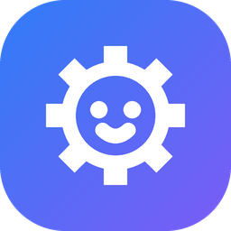

# Пульт и управление

**Русский** · [English](../en/user/remote-control.md)

Экран пульта состоит из шапки и пяти карточек: **Управление**, **Робот** (комната эмулятора или радар), **Датчики**, **Свет**, **Моторы**.

## Шапка

| Элемент | Что делает |
|---|---|
| **Пульт / Блоки / Python / C#** | Режимы. Пульт, [блоки](blocks.md), [Python](python.md) и [C#](csharp.md). |
| Плашка робота | Состояние связи и сборка. Нажмите, чтобы подключить, сменить или отключить робота. Точка: серая — нет робота, жёлтая — подключение, зелёная — на связи, красная — связь потеряна. |
| ☰ | Журнал протокола: байты между компьютером и роботом. Нужен для разработки. |
| ? | Подсказка по клавишам. Тоже открывается по **F1**. |
| ⚙ | Оформление и предел мощности. |
| **СТОП** | Останавливает все моторы. Работает всегда, даже если роботом управляет программа или другой пульт. Пока робот едет, кнопка пульсирует. |

## Управление

**Кнопки или джойстик.** На вкладке «Кнопки» стрелки на экране работают как клавиши: нажали и держите. На вкладке «Джойстик» тяните кружок мышкой или пальцем: чем дальше от центра, тем быстрее.

**Клавиатура** работает всегда, когда открыт пульт:

| Клавиши | Действие |
|---|---|
| W, ↑ | Вперёд |
| S, ↓ | Назад |
| A, D (←, →) | Поворот: с газом — дуга, без газа — на месте |
| Q, E | Разворот на месте |
| Пробел, Esc | СТОП |
| F1 | Подсказка |

**Геймпад.** Подключите его, и в карточке появится его название. Левый стик управляет газом и поворотом, причём малые отклонения дают медленное точное движение. Крестовина работает как стрелки. **B / ○ / Start** — СТОП.

**Скорость** — доля от предела мощности сборки. Например, при пределе 60 % и скорости 50 % моторы получают 30 %.

## Комната эмулятора

Показывается, когда подключён эмулятор. Комната 240 × 160 см, клетка 10 см.

- **Нарисовать препятствие:** зажмите мышь на пустом месте и протяните.
- **Удалить препятствие:** двойной щелчок по нему.
- **«На старт»** возвращает машинку на исходное место. **«Убрать препятствия»** очищает комнату.
- **«Комната» / «Линия»** под картой меняют пол. «Комната» — препятствия и стены. «Линия» — белый лист с чёрной трассой-стадионом для [езды по линии](line-following.md); машинка встаёт на трассу.
- Лучи — датчики, светлая линия за машинкой — её путь. Если машинка упёрлась в стену, она подсвечивается.
- Датчики, которые смотрят в пол, видны квадратиками перед машинкой: чёрный квадратик — под ним линия, белый — лист.
- **«Наклонить»** — стрелки наклоняют машинку вперёд, назад, влево или вправо на 30°, пока кнопку держат. Так проверяют программы с «наклонён?» и «когда наклонён» без настоящего робота. Комната эмулятора видна и на вкладках «Блоки», Python и C#, поэтому наклонять можно прямо во время работы программы.

## Радар (настоящий робот)

Для настоящего робота вместо комнаты виден радар. Лучи показывают, в какую сторону смотрит каждый датчик и что он видит. Короткий красный луч означает, что препятствие близко. Датчики, которые смотрят в пол, нарисованы квадратиками перед роботом с подписью «чёрное» или «белое». Если датчиков на роботе нет, радар пустой — это нормально.

## Датчики

- **Расстояние**: уровень от 0 (вплотную) до 6 (далеко или ничего нет). Полоска из 7 делений: красные — близко, жёлтые — средне, зелёные — далеко. Когда датчик откалиброван, рядом видны сантиметры.
- **Где стоит датчик.** В наборе SuperBot два датчика (ИК), и в каждой модели их ставят по-своему. Название датчика («Спереди», «Справа») — это кнопка: щёлкните и выберите, где он стоит на вашем роботе: спереди, сзади, слева, справа или наискосок. Радар, комната эмулятора и блоки «расстояние впереди» сразу это учтут.
- **Датчик смотрит в пол.** В списке есть группа «Смотрит в пол: линия»: «Вниз», «Вниз слева», «Вниз справа». Тогда вместо расстояния карточка показывает **«Чёрное»** или **«Белое»** и уровень; полоска серая, тёмные деления — зона чёрного (с порога, обычно с 3). Так робот ездит по линии: [Езда по линии](line-following.md).
- **Датчика нет.** Если в вашей модели датчика нет, выберите **«Нет на роботе»**: строка пропадёт, а внизу появится «Нет на роботе: D1» с кнопкой **«Вернуть»**. Робот всё равно присылает какие-то числа, даже без датчика, поэтому Gearbit сам этого не узнает.
- Выбор запоминается для каждой сборки на этом компьютере.
- **Батарея**: пока сырое значение от робота. Если оно низкое, карточка подсвечивается.
- **Наклон X / Y**: гироскоп есть только у роботов с новой прошивкой. У старой прошивки этой карточки нет.

## Свет

Строка **«Все»** красит все светодиоды сразу, остальные строки — по одному (L1–L4). Перечёркнутый кружок выключает светодиод.

## Моторы

Ползунок на каждый мотор: вправо — вперёд, влево — назад. Двойной щелчок по ползунку возвращает его в 0. Пока ползунок не в нуле, мотор крутится. СТОП возвращает все ползунки в 0.

## Кто управляет роботом

Роботом в каждый момент управляет кто-то один: этот пульт, другое окно Gearbit или программа на Python/C#. Если управляет кто-то другой, сверху появится жёлтая полоска с кнопкой **«Забрать управление»**. СТОП работает у всех и всегда.

Если идут [замеры протокола](measurements.md), пульт выключен, а на жёлтой полоске есть кнопка **«Закончить замеры»**.

## Настройки (⚙)

- **Язык · Language:** «Русский» или «English». Страница перезагрузится, программы на вкладках останутся на месте.

- **Тема:** День, Ночь или Авто (как в Windows). Ночная тема не слепит вечером.
- **Цвет:** Океан, Лес, Закат, Космос, Конфета.
- **Крупный текст:** для большого монитора на расстоянии или для маленьких читателей.
- **Предел мощности моторов** (когда подключён робот): общий предел для пульта и программ. Сборка «Машинка» предлагает 60 %. Поднимать предел стоит взрослому.

### Что Gearbit запоминает

На этом компьютере, в файле `%LOCALAPPDATA%\Gearbit\settings.json`:

- язык, тему, цвет и крупный текст;
- скорость и вид управления (кнопки или джойстик);
- где стоят датчики — для каждой сборки;
- последнюю вкладку: Gearbit открывается там, где вы закончили;
- последнюю сборку для каждого робота: в окне подключения она уже выбрана.

Окно Gearbit.exe открывается там же и того же размера, что при закрытии. Предел мощности не запоминается: при каждом подключении его заново предлагает сборка.
